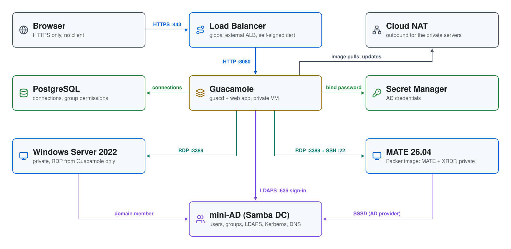

# Apache Guacamole + Active Directory on GCP

A browser-only gateway into a **private** Windows and Linux environment.
**Apache Guacamole** sits behind a Google Cloud global external Application
Load Balancer. Users sign in with their Active Directory account, then open
an RDP session to a Windows host, or a MATE desktop (over XRDP) or an SSH
session on a Linux host, all in the browser and all as themselves. No server
has a public IP, and there's no VPN, bastion or SSH key to hand out.

| Piece | Where | Role |
|---|---|---|
| **Load balancer** (global external Application Load Balancer) | Google's edge | HTTPS with a self-signed certificate generated by Terraform; HTTP redirects to HTTPS. The only internet-facing piece. |
| **Guacamole** | `guacamole-subnet`, private | guacd + the Guacamole web app + PostgreSQL, in Docker, on Ubuntu 24.04 |
| **Windows Server 2022** | `guacamole-subnet`, private | joined to AD; RDP from Guacamole only |
| **MATE on Ubuntu 26.04** | `guacamole-subnet`, private | Packer-built image (Ubuntu MATE core + XRDP + Firefox); joined to AD with SSSD at boot; RDP and SSH from Guacamole only |
| **mini-AD** (Samba DC) | `guacamole-subnet`, private | users, groups, DNS, Kerberos, LDAPS |
| **Secret Manager** | project | AD credentials (`<user>-ad-credentials-guacamole`) |
| **Cloud NAT** | Cloud Router | outbound internet for the private servers |

## Architecture

<picture>
  <source media="(prefers-color-scheme: dark)" srcset="architecture-dark.svg">
  
</picture>

Regenerate with `python3 make_diagram.py`.

- **`01-directory/`**: the VPC and subnet, the firewall rules, Cloud Router
  and Cloud NAT, the AD credentials in Secret Manager, and the
  [`module-gcp-mini-ad`](https://github.com/mamonaco1973/module-gcp-mini-ad)
  Samba DC with users and POSIX attributes from `users.json`. The module
  adds a Cloud DNS forwarding zone so the domain resolves to the DC.
- **`02-packer/`**: builds the MATE image from Canonical's Ubuntu 26.04
  image family: Ubuntu MATE core (no office, mail or media apps), Firefox
  as a snap, XRDP with a MATE session, and the SSSD and realmd packages.
  The domain join is left to boot time, because a computer account and
  keytab can't be baked into a shared image.
- **`03-servers/`**: the load balancer and its certificate, the Guacamole
  server, and the MATE and Windows hosts.

## How sign-in works

1. The user browses to the load balancer and signs in to Guacamole as an AD
   user (`jsmith`). Guacamole checks the password against AD over **LDAPS**.
   Only members of **`mcloud-users`** are allowed in.
2. Guacamole's PostgreSQL database holds three connections: **Windows
   (RDP)**, **MATE (RDP)** and **MATE (SSH)**. They're granted to a database
   group named `mcloud-users`, and Guacamole applies that group to anyone who
   belongs to the AD group of the same name.
3. All three use Guacamole's `${GUAC_USERNAME}` / `${GUAC_PASSWORD}`
   tokens, so each session logs in to the target **as the signed-in user,
   with their AD password**. One sign-in reaches both machines.
   - Windows RDP uses NLA with the `MCLOUD` domain.
   - XRDP doesn't support NLA, so the MATE RDP connection uses TLS security
     and no domain; PAM and SSSD check the bare username against AD.
4. Members of **`linux-admins`** (jsmith and rpatel) also get Guacamole's
   administer right, so they can add connections in the UI. The built-in
   `guacadmin`/`guacadmin` account is disabled.

Who is an administrator where (from `01-directory/scripts/users.json.template`):

| User | `linux-admins`: sudo on MATE + Guacamole admin | `Domain Admins`: admin on Windows and in AD |
|---|---|---|
| jsmith | yes | yes |
| rpatel | yes | yes |
| edavis | no | no |
| akumar | no | no |

All four are in `mcloud-users`, so all four can sign in to Guacamole and
use all three connections.

For LDAPS, Guacamole must trust the DC's certificate. The Samba DC creates
its own CA and serves it at `http://ad1.<domain>/ca.pem`. The Guacamole
server fetches it at boot and puts it in a Java trust store for the web app.

## Firewall rules

```
internet ─443/80─▶ Load Balancer ─8080─▶ Guacamole ─3389──────▶ Windows
                                                    └─22, 3389─▶ MATE
```

A custom VPC denies all ingress by default, so the rules in
`01-directory/firewall.tf` are the complete list. They match on the
servers' network tags (`guacamole`, `windows`, `mate`):

| Rule | From | To |
|---|---|---|
| `guacamole-allow-lb` | Google Front Ends and health checks (`35.191.0.0/16`, `130.211.0.0/22`) | `guacamole` on 8080 |
| `guacamole-allow-windows-rdp` | tag `guacamole` | `windows` on 3389 |
| `guacamole-allow-mate` | tag `guacamole` | `mate` on 22 and 3389 |
| `guacamole-allow-iap-ssh` | IAP (`35.235.240.0/20`) | `guacamole` and `mate` on 22 |

The mini-AD module opens the AD ports on the DC itself.

Admin access to the private Linux servers is **SSH through IAP**, which
needs no public IP. For example:

```bash
gcloud compute ssh guacamole-<suffix> --zone us-central1-a --tunnel-through-iap \
  --command 'sudo tail -50 /root/userdata.log'
```

## Prerequisites

* [A Google Cloud project](https://console.cloud.google.com/) and a service
  account key for it, saved as `credentials.json` in the repo root (it is in
  `.gitignore`). `check_env.sh` signs in with it and enables the APIs the
  build needs (`api_setup.sh`).
* [Install gcloud](https://cloud.google.com/sdk/docs/install)
* [Install Terraform](https://developer.hashicorp.com/terraform/install)
* [Install Packer](https://developer.hashicorp.com/packer/install)
* [Install jq](https://jqlang.github.io/jq/download/) and `curl`

## Deploy

```bash
./apply.sh       # 1: VPC + secrets + mini-AD  2: MATE image (Packer)  3: load balancer, Guacamole, servers
./validate.sh    # waits for Guacamole, signs in as jsmith, prints the URL
```

The Packer build takes about 15 minutes, and each run of `apply.sh` builds a
fresh image. Phase 3 always uses the newest one.

`validate.sh` waits for the load balancer to report Guacamole healthy, then
signs in to Guacamole's API as `jsmith` and checks that all three
connections are granted. That exercises LDAPS, the group gate and the
database permissions. It also checks the HTTP redirect and that no VM has a
public IP. It ends with:

```
Guacamole + Active Directory
============================
URL      : https://203.0.113.10/
           Self-signed certificate: the browser warns once;
           choose Advanced > Proceed.
Sign in  : jsmith / orange-481920
           (any mcloud-users member; passwords in Secret Manager
           as <user>-ad-credentials-guacamole)
Connect  : Windows (RDP), MATE (RDP desktop) and MATE (SSH),
           as the signed-in user.
```

## Try it

1. Open the URL, accept the certificate warning, and sign in as `jsmith`.
2. Click **MATE (RDP)**: a MATE desktop opens as `jsmith`, whose home
   directory is created on first login. Firefox is on the desktop and is
   the default browser. **MATE (SSH)** gives a terminal on the same host.
   Try `id`, `getent group linux-admins`, and `sudo -l` (linux-admins have
   passwordless sudo).
3. Go back (Ctrl+Alt+Shift opens the Guacamole menu) and click **Windows
   (RDP)**: a desktop opens as `MCLOUD\jsmith`. **Active Directory Users and
   Computers** is installed, and jsmith is a local administrator through
   `Domain Admins`.
4. Sign out and sign in as `edavis`: the same three connections, as edavis.
   edavis isn't in `linux-admins` or `Domain Admins`, so there's no
   Guacamole admin menu, no sudo on MATE, and only a standard user's rights
   on Windows. (rpatel, like jsmith, is an admin everywhere.)

User passwords are in Secret Manager as `<user>-ad-credentials-guacamole`:

```bash
gcloud secrets versions access latest --secret=edavis-ad-credentials-guacamole \
  | jq -r .password
```

## Troubleshooting

| Symptom | Fix |
|---|---|
| `validate.sh`: backend not healthy | Guacamole's setup is still running or failed. `gcloud compute ssh guacamole-<suffix> --zone us-central1-a --tunnel-through-iap --command 'sudo tail -50 /root/userdata.log'`. |
| HTTPS answers 404 or 502, or the connection resets, right after `apply.sh` | A new load balancer takes several minutes to start serving on its IP. `validate.sh` waits for it. |
| Sign-in fails for everyone | LDAPS: on the Guacamole server, `cd /opt/guacamole && sudo docker compose logs guacamole`. Check `/opt/guacamole/tls/ca.pem` was fetched from the DC. The DC must be built from a mini-AD module version that serves `/ca.pem`. |
| One user can't sign in | They must be in AD group `mcloud-users`. |
| Windows (RDP) disconnects at once | Check the domain join in the serial console log: `gcloud compute instances get-serial-port-output win-ad-<suffix> --zone us-central1-a \| grep windows-startup-script`. The script joins the domain and reboots once; on later boots it logs "Already joined". |
| MATE (SSH or RDP) rejects the password | The host hasn't finished its domain join; check `/root/userdata.log` over IAP SSH. |
| SSH prompt shows `start=...;type=shell;cwd=...` text | systemd 258+'s OSC 3008 prompt escapes, which Guacamole's terminal prints instead of hiding. A tmpfiles.d rule re-creates `/etc/profile.d/80-systemd-osc-context.sh` at every boot, so the image masks the rule (`02-packer/scripts/03-xrdp.sh`). On an older image: `sudo ln -sf /dev/null /etc/tmpfiles.d/20-systemd-osc-context.conf && sudo rm -f /etc/profile.d/80-systemd-osc-context.sh`. |
| MATE (RDP) connects, then closes | Check `/var/log/xrdp-sesman.log` on the host. The session runs `/etc/xrdp/startwm.sh`, which starts MATE. |
| Firefox doesn't open in the desktop ("Authorization required") | Snaps need `XAUTHORITY` exported; `/etc/xrdp/startwm.sh` does that. Sessions started before an image change keep the old environment: sign out and back in. |
| Remote session drops after a while | On this load balancer the backend service timeout is the longest a WebSocket can stay open. `03-servers/loadbalancer.tf` sets it to 24 hours. |
| Packer fails with "time out while waiting for image to register" | GCP was slow to register the image. `02-packer/mate.pkr.hcl` allows 30 minutes (`state_timeout`); re-run `./apply.sh`. |
| A VM fails to create: "does not have enough resources available" | The zone is temporarily out of that machine type. Re-run `./apply.sh` later, or change `zone` in `03-servers/variables.tf`. |
| Browser certificate warning | Expected: the certificate is self-signed. Use a Google-managed certificate and a DNS name pointed at the load balancer to remove it. |

## Teardown

```bash
./destroy.sh     # destroys phase 3, deletes the MATE images, destroys phase 1
```

`destroy.sh` skips any phase that has nothing left, so it is safe to re-run.

## Notes

- **Lab only.** The certificate is self-signed, the load balancer is open to
  the internet (add a Cloud Armor policy to limit who can reach it), and
  Guacamole binds to LDAP with the domain admin account (its password is in
  the server's `/opt/guacamole/.env`, readable only by root). Use a
  dedicated read-only bind account and a real certificate for anything more.
- **Cost.** The load balancer's forwarding rules have an hourly charge while
  they exist, even with no traffic. Run `./destroy.sh` when you are done.
- The servers read secrets from Secret Manager with their service account's
  token from the metadata server, so the images don't need gcloud.
- Users, groups and POSIX IDs are defined in
  `01-directory/scripts/users.json.template`.
- `04-utils/` has PowerShell helpers that ask the DC for the next free
  UID/GID, for creating POSIX users from the Windows host.
